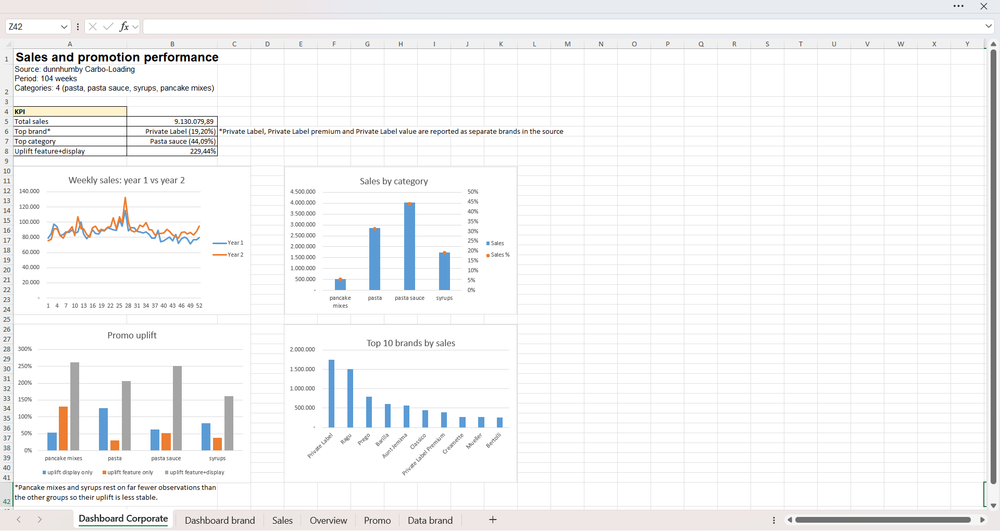
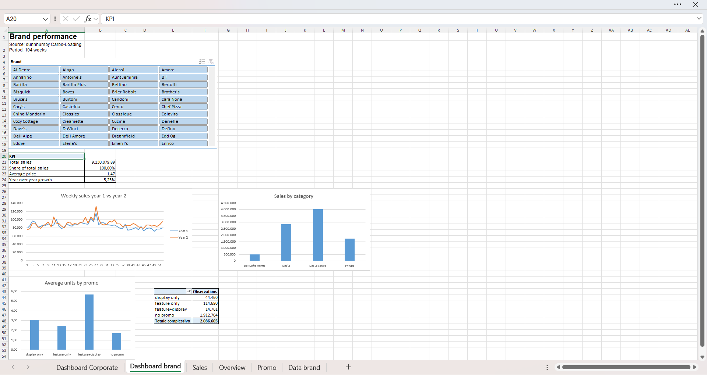
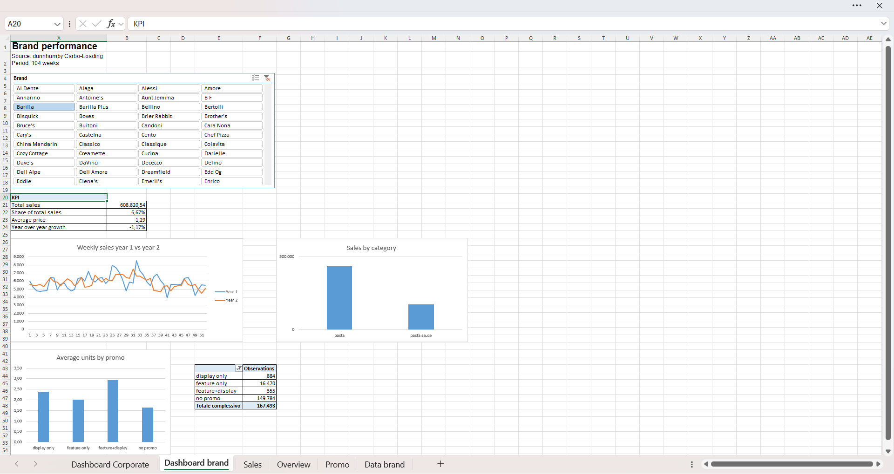

# Sales and promotion analysis: dunnhumby Carbo-Loading
Personal data analysis project that simulates periodic reporting for brand teams and corporate management. The objective of this dashboard is to present relevant metrics about sales and KPIs for 4 food categories (pasta, pasta sauce, syrups and pancake mixes) from the dunnhumby Carbo-Loading dataset, and to measure the uplift in unit sales during in-store display and flyer promotions.

## Dashboard

The Excel workbook has two views, both built on the same Data Model.

!!inserisci link excel

**Corporate view**: summary for management with total sales, top brand, top category, uplift of feature + display, weekly sales by year, sales by category, top 10 brands and promo uplift by category.

**Brand view**: a slicer selects any of the 131 brands and updates four KPIs (total sales, share of total sales, average price per unit, year-over-year growth), three charts (weekly sales, sales by category, average units by promo type) and a table with the number of observations behind each promo type.





## Data
Source: public dataset Carbo-Loading from dunnhumby
|Item|Values|
|---|---|
| Period | 104 weeks (2 years) |
| Categories | 4 (pasta, pasta sauce, syrups, pancake mixes) |
| Products / brands | 927 products, 131 brands |
| Transactions | about 5.2 million rows |
| Total sales | $9.130.079,89 |

Tables used: dh_transactions, dh_product_lookup, dh_causal_lookup.

The original files are not included because of their size. They can be downloaded from the [dunnhumby Source Files page](https://www.dunnhumby.com/source-files/).

## Method 
**Tools**: SQL (DB Browser for SQLite), Excel (Power Query, Pivot Tables, Pivot charts, DAX measures)

1. **Import** of the 3 CSV files into DB browser for SQLite.
2. **Aggregation in SQL**: transactions (one row per item) are grouped by week, store and product; joined to category and brand (JOIN) and to promotions (LEFT JOIN). Indexes on upc, store, week speed up the joins.
3. **Promotion classification** into five states: no promo, display only, feature only, feature + display, N/A.
4. **Final table** of 11.221 rows (week, category, brand, promo type, observations, sales, units), exported to CSV.
5. **Excel**: import with Power Query, year column (weeks 1-52 = Year 1, weeks 53-104 = Year 2), Data Model, Pivot tables and charts.
6. **Uplift** = average units per observation with promotion ÷ average units per observation without promotion − 1, where an observation is one product-store-week combination. The average is a DAX measure: DIVIDE(SUM(Units), SUM(Observations)).
7. **Brand view**: DAX measures (Total sales, Share of total sales, Average price, Year over year growth) and a slicer on brand connected to the brand pivots. The Corporate pivots are not connected to the slicer.

Total sales were compared at three points: the original transactions table, the SQL output and Excel. All match ($9,130,079.89), so the joins neither lost nor duplicated rows.

Query used:
```sql
CREATE INDEX IF NOT EXISTS idx_t ON dh_transactions(upc, store, week);
CREATE INDEX IF NOT EXISTS idx_c ON dh_causal_lookup(upc, store, week);
CREATE TABLE vendite_promo AS
WITH base AS (
     SELECT week,store,upc,
	        SUM(dollar_sales) AS vendite,
			SUM(units) AS unita
	 FROM dh_transactions
	 GROUP BY week, store, upc
)
SELECT
  b.week,
  p.commodity AS categoria, 
  p.brand,
CASE
  WHEN b.week < 43 THEN 'N/D'
  WHEN c.upc IS NULL THEN 'nessuna' 
  WHEN c.feature_desc <> 'Not on Feature' AND c.display_desc <> 'Not on Display' THEN 'volantino+display'
  WHEN c.feature_desc <> 'Not on Feature' THEN 'solo volantino'
  WHEN c.display_desc <> 'Not on Display' THEN 'solo display'
  ELSE 'nessuna'
 END AS tipo_promo,
 COUNT (*) AS osservazioni,
 SUM (b.vendite) AS vendite,
 SUM (b.unita) AS unita
FROM base b
JOIN dh_product_lookup p ON p.upc = b.upc
LEFT JOIN dh_causal_lookup c
  ON c.upc = b.upc AND c.store = b.store AND c.week = b.week 
GROUP BY 1,2,3,4;
```

[sql for dunnhumby-carbo.sql](https://github.com/user-attachments/files/34928691/sql.for.dunnhumby-carbo.sql)

The SQL output uses Italian labels, which were translated to English in Power Query.

| SQL output | Excel (English) |
|---|---|
| categoria | Category |
| tipo_promo | Promo type |
| osservazioni | Observations |
| vendite | Sales |
| unita | Units |

| Promo label in SQL | Label in Excel |
|---|---|
| nessuna | no promo |
| solo volantino | feature only |
| solo display | display only |
| volantino+display | feature+display |
| N/D | N/A |

Year and week of year were added in Power Query.

## Limitations and assumptions

- **Promotion data covers only weeks 43-104.** For weeks 1-42 the source does not say whether a product was promoted, so those rows are labelled N/A and excluded from the uplift.
- **The promotion table lists only product-store-week combinations with at least one promotion.** A missing row was interpreted as "no promotion".
- **Years** are defined as weeks 1-52 and 53-104; the source does not label years.
- **Uplift is a simple comparison.** It does not control for price, coupons, seasonality or the fact that promoted products and stores may have been chosen because they sell more, which would overstate uplift. In the opposite direction, a product-store-week appears only if at least one sale occurred, which affects both promoted and non-promoted groups. The net effect was not tested.
- **No cost or margin data**, so margin and promotional ROI cannot be calculated.
- **Brand-level promotion results can rest on small groups.** For example, Barilla has 355 observations with feature + display, so the Brand view shows the number of observations next to the averages.
- **Stores are numeric codes only**, so there is no store-level analysis.
- **No budget data**: the comparison is Year 2 vs Year 1.

## Key findings

**Sales**
- Total sales are $9.13M over 104 weeks. Year 2 is +5.3% vs Year 1 ($4.68M vs $4.45M).
- Weekly sales follow a very similar pattern in both years, with a clear peak in week 27 of each year. The cause was not investigated.
  
**Categories and brands**
- Pasta sauce (44.1%) and pasta (31.2%) make up about 75% of sales; syrups account for 19.1% and pancake mixes for 5.6%.
- Sales are concentrated: the top 10 brands represent 75.1% of total sales. The largest are Private Label (19.2%), Ragu (16.4%), Prego (8.8%), Barilla (6.7%) and Aunt Jemima (6.2%).
- *Private Label, Private Label Premium and Private Label Value are separate brands in the source data and are kept separate here.*

**Promotions** (weeks 43-104 only)
- Only about 8% of product-store-week combinations had a flyer or display.
- Average units sold per product-store-week are higher in every promoted group than without promotion.

Uplift vs. no promotion:

| Category | Display only | Feature only | Feature + display |
|---|---|---|---|
| Pancake mixes | +54% | +131% | +262% |
| Pasta | +126% | +30% | +206% |
| Pasta sauce | +63% | +52% | +251% |
| Syrups | +81% | +38% | +161% |
| **All categories** | **+79%** | **+43%** | **+229%** |

- Feature + display gives the highest uplift in all four categories.
- In pasta, pasta sauce and syrups, display only beats feature only. In pancake mixes the opposite is true (+131% vs +54%).
- Pasta and pasta sauce have large groups in every column, so their results are the most stable. Pancake mixes and syrups rest on far fewer observations, so their uplift is less stable.

**Repostory contents**
- README.md
- [sql for dunnhumby-carbo.sql](https://github.com/user-attachments/files/34928691/sql.for.dunnhumby-carbo.sql):SQL query
-  
